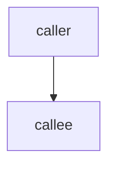

# Templates

Defaults for when the repo has no format of its own. A repo's existing format wins.

## docs/architecture.md

````markdown
# Architecture

**Status:** Draft, backfilled <today> from the code at <commit>. Line numbers hold at that commit only. Claims are labeled
**[V]** verified, **[I]** inferred or **[U]** unknown; each [V] and [I] names its source.

## Purpose and boundary
<What the system does. What it does not do: [V] only if a doc or issue says so, else [I] or [U].>

## Components
| Component | Responsibility | Contract | Evidence |
|---|---|---|---|
| `<dir or module>` | <one responsibility> | `<file that defines its interface>` | [V] `<path>` `<symbol>` |

## Dependency graph

Edges counted with: `<command the reader can re-run>`.

## Key flows
1. <Flow name>: `a` -> `b` -> `c` [V|I] `<path>` `<symbol>`

## Invariants and rules
- <Rule the code relies on.> [V|I] <evidence; for [I], what would disprove it>

## Risks and hot spots
- <Observation, with the files or commits that show it.>

## Unknowns
- <Question.> Checked: <what>. Ask: <who or what could answer>.
````

## ADR (reconstructed)

````markdown
# ADR-NNNN: <the decision, as a statement>

**Status:** Accepted (reconstructed <today>)
**Introduced by:** <commit hash or PR>, <commit date>, <author name>

## Context
<The situation at that time, from the sources below.>

## Decision
<What the code does as a result, with `path` and symbol evidence.>

## Why
<Verbatim quote from the introducing commit, PR or review thread, each with its hash or URL.
If none states a reason: `Reason not recorded.`>

## Inferred rationale
<Optional. Paraphrase and inference go here, with the observations behind them.>

## Consequences
<What this makes easy or hard today, observed in the code or history.>

## Sources
- <commit hash or URL>: <what it shows>
````
